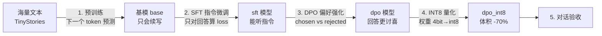

# 大模型全流程教程：预训练 → 微调 → 强化 → 量化

从零实现（纯 PyTorch，不依赖 transformers/trl 等框架），在单张 RTX 3090 上
**约 15 分钟跑完一个 5M 参数大模型的完整生命周期**。



## 1. 快速开始（按顺序执行）

```bash
uv sync                    # 安装依赖（torch-cu130 + datasets）
uv run 1_pretrain.py       # ①  基模预训练（3090 实测约 3 分钟，含数据下载约 5 分钟）
uv run 2_sft.py            # ②  指令微调（< 1 分钟）
uv run 3_dpo.py            # ③  DPO 偏好强化（< 1 分钟）
uv run 4_quantize.py       # ④  INT8 量化 + 前后对比
uv run 5_chat.py           # ⑤  交互对话验收
```

单轮测试：`uv run 5_chat.py --model dpo_int8 --prompt "Give three tips for staying healthy."`

产物：`data/`（数据缓存）与 `checkpoints/`（base/sft/dpo/dpo_int8 四个模型）。

## 2. 四个阶段详解

### ① 基模预训练（Pre-training）— `1_pretrain.py`

| | 说明 |
|---|---|
| 数据 | TinyStories 子集 80k 条英文小故事（GPT-3.5 生成，专为小模型设计） |
| 目标 | 自回归语言建模：给前文，预测下一个 token（交叉熵） |
| 模型 | MiniGPT：6 层 × 4 头 × 256 维，字符级词表 ~100，**约 5M 参数** |
| 关键实现 | Flash Attention（`scaled_dot_product_attention`）、weight tying、bf16 混合精度、余弦退火 + warmup、随机窗口采样 |
| 学到 | 拼写/词法 → 句法 → 小故事叙事套路 |
| 学不到 | 听指令、分辨好坏、低成本部署 → 后面三个阶段 |

**与真实基模的差距**：GPT/Llama 用数万亿 token、数千卡训练数月；本教程把"流程"压缩到
单卡 10 分钟以内 —— 算法结构完全一致，差别只在规模。字符级分词是教学选择（生产用 BPE，
词表 3~15 万，同样文本 token 数少 ~4 倍）。

### ② 指令微调（SFT）— `2_sft.py`

| | 说明 |
|---|---|
| 数据 | Alpaca-Cleaned 子集 8k 条（instruction / input / output） |
| 原理 | 套统一对话模板，**只对 Response 部分计算 loss**（prompt 标签置 -100） |
| 配置 | 全参数微调，LR 1e-4（预训练的 1/30，防止遗忘） |
| 效果 | 从"接着写"变成"看到指令 → 生成回答" |

### ③ 偏好强化（DPO）— `3_dpo.py`

| 方案 | 模型数 | 复杂度 | 适用 |
|---|---|---|---|
| RLHF（RM + PPO） | 4 个（policy/ref/reward/critic） | 高，需采样 rollout | 大厂旗舰模型 |
| **DPO（本教程）** | 2 个（policy/ref） | 低，离线偏好对直接优化 | 小规模对齐首选 |
| GRPO | 2 个 + 组内相对奖励 | 中（DeepSeek-R1 同款） | 推理能力强化 |

- 数据：orca-dpo-pairs 3k 对（同一问题 + 好/坏两个回答）
- 损失：`-log σ(β·[(π_chosen − π_rejected) − (ref_chosen − ref_rejected)])`
- 直觉：让策略相对参考模型，"更偏好好答案"的幅度大于"更偏好坏答案"

### ④ 量化（Quantization）— `4_quantize.py`

| 方案 | 位宽 | 原理 | 场景 |
|---|---|---|---|
| 动态 per-channel（本教程手写） | int8 | `w≈round(w/scale)·scale`，加载时离线量化 | 入门/CPU 提速 |
| GPTQ | int4/8 | 逐层最小化量化误差的 Hessian 逼近 | GPU 服务端部署 |
| AWQ | int4 | 激活感知的保护性量化 | GPU 端侧，精度好 |
| GGUF (llama.cpp) | int2~8 | k-quants + CPU SIMD | 个人电脑/手机 |
| QAT | 任意 | 训练中插伪量化算子，精度最优 | 对精度极度敏感 |

本教程手写 `Int8Linear` 替换全部 `nn.Linear`，量化前后对比体积/PPL/速度。
注意：weight-tied 的 `lm_head` 不可单独量化；GPU 上 int8 matmul 仍以 fp16 执行，
主要收益是**显存与带宽**（CPU 上提速才明显）。

## 3. 文件结构

```
llm/source/
  common.py        字符级 Tokenizer、MiniGPT（GPT 结构）、生成/困惑度、模板、checkpoint
  1_pretrain.py    预训练  → checkpoints/base.pt
  2_sft.py         指令微调 → checkpoints/sft.pt
  3_dpo.py         偏好强化 → checkpoints/dpo.pt
  4_quantize.py    INT8 量化 → checkpoints/dpo_int8.pt
  5_chat.py        对话验收（--model base/sft/dpo/dpo_int8）
```

## 4. 常见问题

- **HF 下载慢**：`export HF_ENDPOINT=https://hf-mirror.com` 后重跑
- **生成质量一般**：5M 模型 + 字符级分词的上限所致；把 `d_model/n_layer/steps` 调大
  （如 512/8/20000，仍 <30 分钟）会明显变好
- **中文模型**：预训练语料换成中文童话/维基子集，字符级词表会扩大到几千汉字，
  建议同时加大 `d_model`；其余三阶段流程不变
- **进阶生产工具**：微调用 LLaMA-Factory / trl（LoRA、多卡），量化用 AutoGPTQ / autoawq /
  llama.cpp，推理服务用 vLLM（见 `../RAG/`）

## 5. 关键指标参考（RTX 3090 实测）

| 阶段 | 耗时 | 实测结果 |
|---|---|---|
| ① 预训练 6000 步 | 3.2 分钟（另含数据下载 ~2 分钟） | loss 0.56，PPL 1.68，续写出通顺小故事 |
| ② SFT 8k×2 epochs | 0.2 分钟 | loss 1.36→1.14，输出从"续写故事"变为"回答指令" |
| ③ DPO 3k×1 epoch | 0.1 分钟 | 隐式准确率 50%→99.7%，故事文本 PPL 1.94→1.96（几乎无损） |
| ④ INT8 量化 | 秒级 | 体积 19.6MB→5.5MB（-72%），PPL +0.000，输出风格保持 |

端到端全流程 **< 10 分钟**（含数据下载），预训练留有 `--max-minutes 25` 保险丝。

### 踩坑实录（本教程开发中真实遇到，值得学习）

1. **标签错位一帧**：SFT 直接把"当前 token"当标签喂给损失，模型秒学成复读机（loss 假象归零、
   生成 '\n' 死循环）。语言模型的目标永远是"下一个 token"，标签必须左移一位。
2. **DPO 过度优化**：偏好差异明显的数据 + 常规 LR 会把 margin 推到 100+ nats，KL 失控、
   生成崩成乱码。对策：降 LR（5e-6）、单 epoch、加 chosen NLL 正则（ln-DPO 技巧）。
3. **非连续张量**：切片后的 batch 传给 `view` 报错，`reshape` 才是安全写法。
