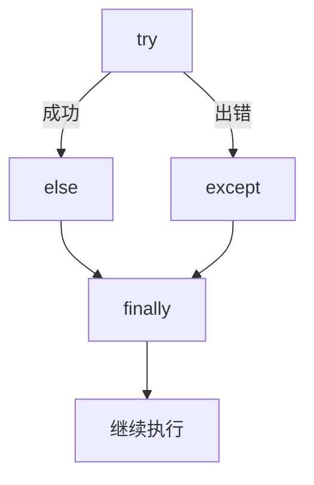

# 异常处理：出错怎么办

<div class="mb-3 p-2 bg-blue-500/10 border-l-4 border-blue-500 rounded text-sm">
<b>异常</b>就是程序运行时的意外。不处理，程序就会中断并打印一大段红色报错。
</div>

## try / except

```python
try:
    number = int(input("请输入一个数字: "))
    result = 100 / number
except ValueError:
    print("错误：请输入有效的数字！")
except ZeroDivisionError:
    print("错误：不能除以零！")
except Exception as e:
    print(f"发生未知错误: {e}")
else:
    print("计算成功完成！")     # 没出错时执行
finally:
    print("异常处理示例结束。")  # 无论怎样都执行
```

`finally` 常用于关闭文件、释放资源。

::right::

## 执行流程



## 常见异常

| 异常 | 触发条件 |
|------|----------|
| `ValueError` | 类型转换失败，如 `int("abc")` |
| `ZeroDivisionError` | 除以零 |
| `KeyError` | 字典键不存在 |

<div class="mt-2 p-2 bg-red-500/10 border-l-4 border-red-500 rounded text-xs">
尽量捕获<b>具体异常</b>，少用“裸” <code>except</code>，否则会把真正的 bug 也藏起来。
</div>

<div class="mt-3 text-xs opacity-50">
对应示例：source/exceptions.py · <code>uv run exceptions.py</code>
</div>
