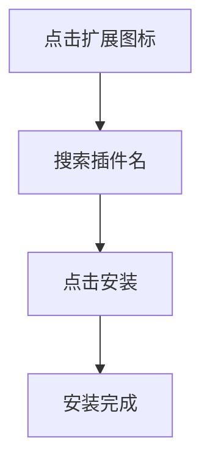

# 环境准备：VSCode 安装

## 下载与安装

- 下载地址：https://code.visualstudio.com/download
- 双击 `VSCodeUserSetup-x64-版本号.exe` 安装
- 按向导默认设置完成即可

## 必备插件

| 插件 | 用途 |
|------|------|
| **rust-analyzer** | Rust 官方语言服务器（补全/类型检查） |
| **CodeLLDB** | 调试器（断点/单步/变量查看） |
| **Even Better TOML** | Cargo.toml 语法支持 |
| **Chinese Language Pack** | 中文语言包（可选） |

::right::

## 插件安装步骤

<b>提示：</b>rust-analyzer 由官方维护，安装后首次打开项目需等待索引建立完成。

