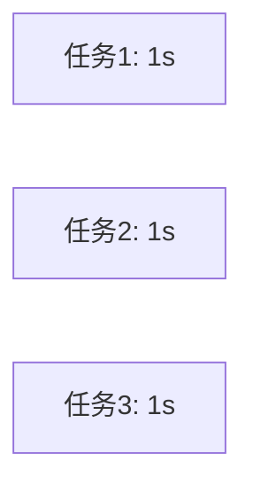

# 异步编程：tokio

## 为什么需要异步？

同步执行（串行）：

总耗时：**3秒**

异步执行（并发）：

总耗时：**约1秒**

::right::

## 代码示例

```rust
use std::time::Duration;

async fn cook(dish: &str, secs: u64) {
    tokio::time::sleep(Duration::from_secs(secs)).await;
    println!("{dish} 完成！");
}

#[tokio::main]
async fn main() {
    // 对应 asyncio.gather
    tokio::join!(
        cook("鱼香肉丝", 1),
        cook("红烧肉", 1),
        cook("青椒肉丝", 1),
    );
    // 总耗时约 1 秒
}
```

## 关键概念

| 关键字 | 作用 | Python 对应 |
|--------|------|-------------|
| `async fn` | 定义异步函数 | `async def` |
| `.await` | 等待完成 | `await` |
| `tokio::join!` | 并发执行多个 | `asyncio.gather` |
| `tokio::spawn` | 后台任务 | `create_task` |
| `#[tokio::main]` | 运行时入口 | `asyncio.run` |

<div class="mt-2 p-3 bg-pink-500/10 border-l-4 border-pink-500 rounded text-sm">
Rust 异步零成本抽象：不占线程、无 GIL，天然多核并发。
</div>
