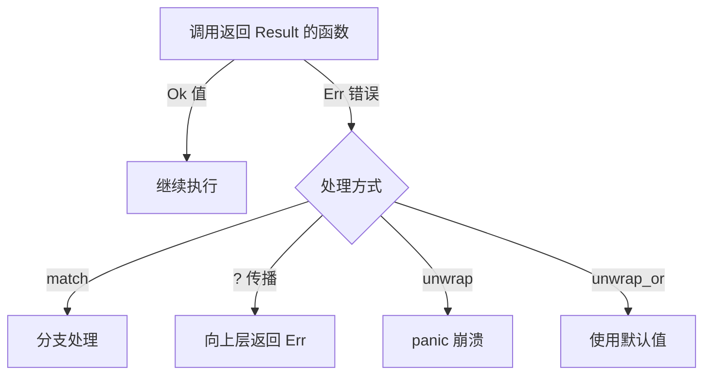

# 错误处理（对应异常）

## 两种策略

| 机制 | 场景 | 类比 |
|------|------|------|
| `panic!` | 不可恢复的 bug | 程序崩溃 |
| `Result<T, E>` | 可预期的失败 | try/except |

## Result：错误写进类型

```rust
fn divide_100_by(input: &str)
    -> Result<f64, ParseError>
{
    let n: f64 = input.parse()      // 可能失败
        .map_err(|_| ParseError::NotANumber(input.to_string()))?;
    //  ↑ ? 运算符：出错立即 return Err

    if n == 0.0 {
        return Err(ParseError::ZeroDivision);
    }
    Ok(100.0 / n)
}

// 用 match 处理（对应 try/except）
match divide_100_by("5") {
    Ok(v) => println!("结果: {v}"),
    Err(e) => println!("出错: {e}"),
}
```

::right::

## 执行流程



## 常见错误处理方法

| 方法 | 行为 |
|------|------|
| `unwrap()` | Err 时 panic（慎用） |
| `expect("原因")` | 同上，带提示 |
| `unwrap_or(v)` | 使用默认值 |
| `?` | 向上传播 |
| `map_err(f)` | 转换错误类型 |

<div class="mt-2 p-3 bg-rose-500/10 border-l-4 border-rose-500 rounded text-sm">
Python 靠运行时捕获异常，Rust 靠<b>编译期强制</b>：忘记处理错误编译不过。
</div>
