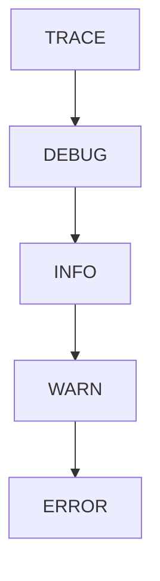

# 进阶：tracing 日志

## 为什么用 tracing？

`println!` 的局限性：
- 无法区分日志级别
- 无法控制输出格式
- 无法按模块过滤
- 无法接入链路追踪

## 基本配置

```rust
fn main() {
    tracing_subscriber::fmt()
        .with_env_filter(
            tracing_subscriber::EnvFilter::from_default_env()
                .add_directive(tracing::Level::INFO.into())
        )
        .init();
}
```

::right::

## 五个日志级别

```rust
use tracing::{trace, debug, info, warn, error};

trace!("追踪信息");   // 不输出
debug!("调试信息");   // 不输出
info!("一般信息");    // 输出
warn!("警告信息");    // 输出
error!("错误信息");   // 输出
```

## 结构化日志（Python 没有的优势）

```rust
let name = "张三";
info!(姓名 = name, 年龄 = 25, "用户登录");
// INFO 用户登录 姓名="张三" 年龄=25
```

## 级别层级



环境变量控制级别：`RUST_LOG=debug cargo run`

<div class="mt-2 p-3 bg-cyan-500/10 border-l-4 border-cyan-500 rounded text-sm">
tracing 是 Rust 生态事实标准，生产环境替代 println!，便于排查和监控。
</div>
